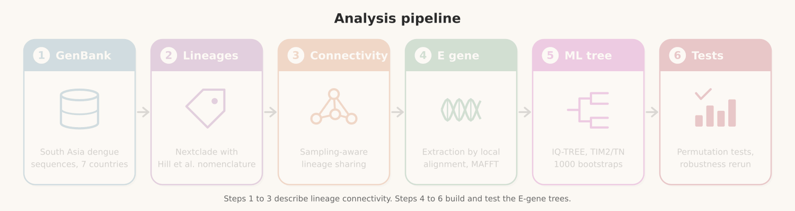

# Dengue lineages across South Asia

Public GenBank sequences, Nextclade lineages and envelope-gene trees show how dengue virus lineages are shared between South Asian countries.

## Explore

| Folder | What you find there |
|---|---|
| [`notebooks/`](notebooks) | Kaggle notebooks for the analysis |
| [`data/`](data) | Sequence metadata and lineage table |
| [`results/`](results) | Tables, alignments and trees produced by the notebooks |
| [`figures/`](figures) | Image used on this page |

## Data and citation

The data are archived on Zenodo: https://doi.org/10.5281/zenodo.24568270

## Author

Md. Abu Sayem, M.Tech CSE (AI/ML), Manav Rachna International Institute of Research and Studies.

## License

Code under the MIT License. Sequence data belong to their original submitters and are available from NCBI GenBank.
