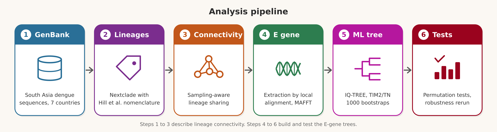
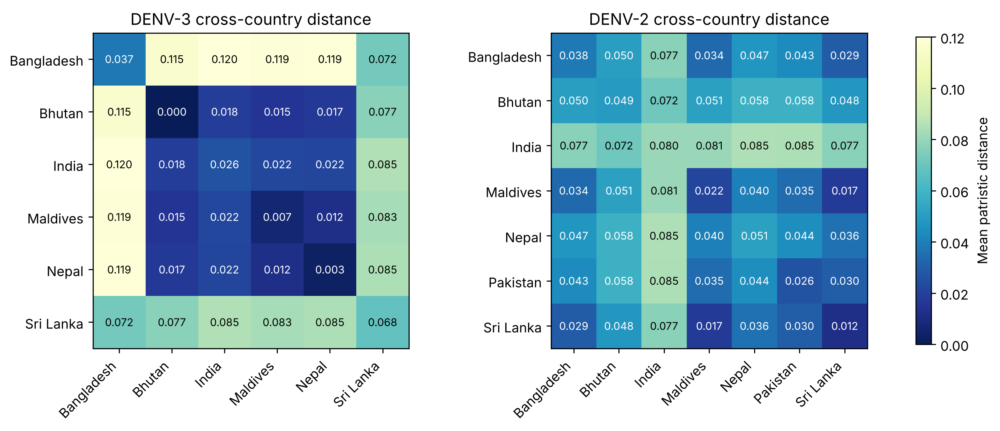
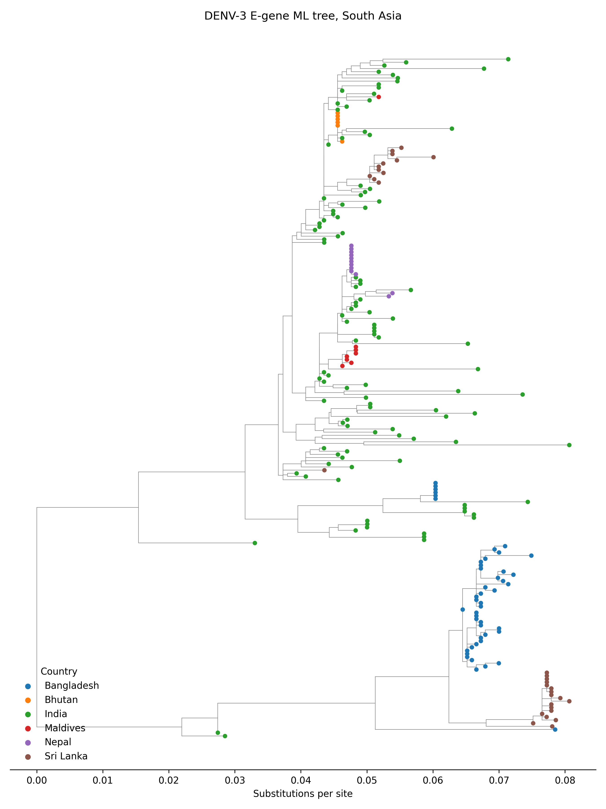
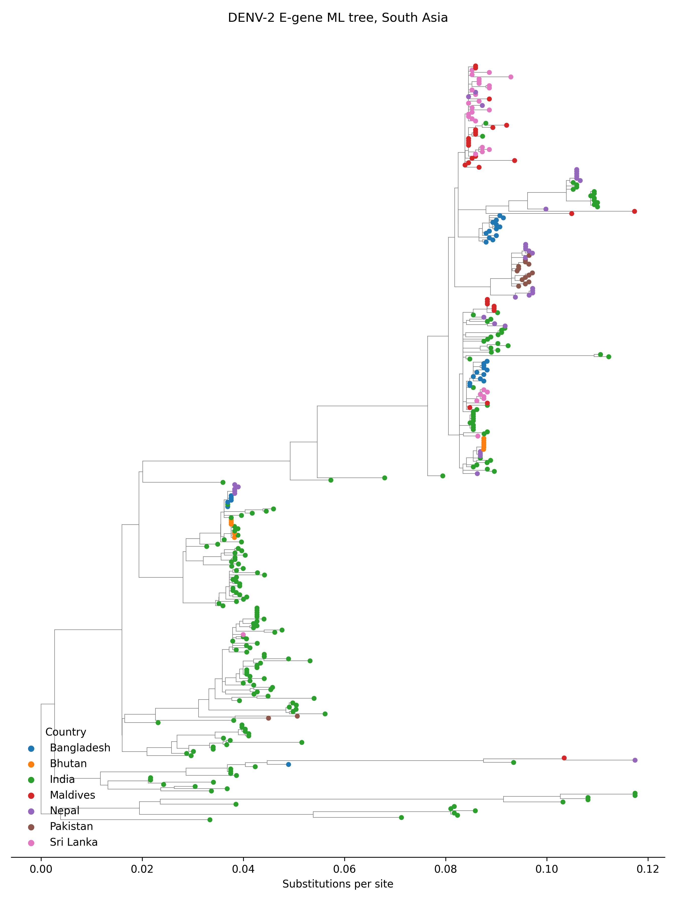
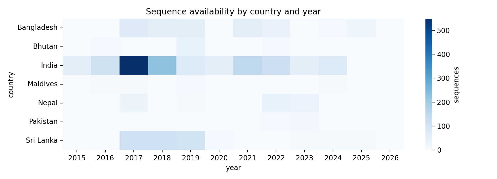
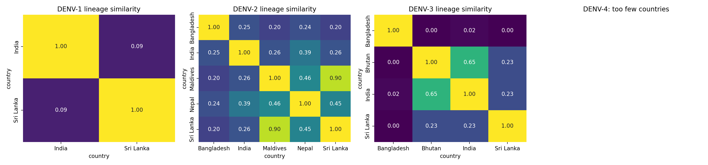

# Dengue E-gene phylogeny and lineage connectivity across South Asia

Descriptive molecular epidemiology of dengue virus serotypes 2 and 3 across South Asia, with a focus on Bangladesh and its neighbours. The analysis uses public GenBank sequences, Nextclade lineage assignment, maximum-likelihood trees of the envelope (E) gene and permutation-based tests of geographic structure.

This repository holds the data, notebooks and results behind the manuscript. It is related to the M.Tech thesis on cross-border dengue early warning (Bangladesh and India) but is a separate, self-contained study.



## Main findings

| Serotype | Finding | Support |
|---|---|---|
| DENV-3 | Bangladesh genotype I (`3I_A.2`) forms its own clade. Its closest relative is Sri Lankan genotype I (`3I_A.1.1`), not Indian virus. | Clade bootstrap 100 in the robustness run |
| DENV-3 | Bangladesh to Sri Lanka distance 0.072, Bangladesh to India 0.120 (mean patristic distance) | Robustness run, 206 tips |
| DENV-2 | Sri Lanka, Maldives, Nepal and Bangladesh mix inside the cosmopolitan `2II_F.1.1` clade | Sri Lanka to Maldives 0.017, Bangladesh to Sri Lanka 0.030 |
| DENV-2 | Bangladesh shows several lineages over time (`2II_A.2.1`, `2II_F.1.1.2`, `2II_F.1.1`) | 31 Bangladesh tips, years 2017 to 2025 |
| Both | Within-country distances are below the permutation null for most countries (p = 0.002 with 500 shuffles) | Sri Lanka DENV-3 is the exception (two genotypes) |



### Trees

DENV-3 E-gene tree, coloured by country:



DENV-2 E-gene tree, coloured by country:



### Animated view by country

Each frame highlights one country on the robustness-run tree. The Bangladesh DENV-3 tips sit in one lower clade with Sri Lanka as its neighbour, while the DENV-2 countries spread across the large cosmopolitan clade.


### Lineage connectivity and sampling





## Data and dataset link

All sequences come from NCBI GenBank (nucleotide database). Accession numbers, country, year and lineage for every record are in `data/lineage_assigned.csv`, so the full sequence set can be rebuilt from GenBank.

| Item | Location |
|---|---|
| Lineage table (2,515 rows, input to the notebooks) | `data/lineage_assigned.csv` |
| Raw availability table, 8 countries and 4 serotypes | `data/denv_southasia_raw.csv` |
| Kaggle dataset used by the notebooks | https://www.kaggle.com/datasets/YOUR-KAGGLE-USERNAME/lineage-dengue-dataset |
| Archived release with DOI (optional) | https://doi.org/YOUR-ZENODO-DOI |

Replace the two placeholder links above with the real dataset URL and DOI before publishing the repository.

Notes on the data:

- Source is GenBank only. GISAID sequences are not used.
- A few accessions appear under two countries in the raw table. The phylogeny notebook removes these by keeping the row whose country matches the GenBank `geo_loc_name` field.
- Afghanistan has no usable sequences.
- Sequences are from 2015 onward, which is too short a window for a reliable molecular clock.

## Repository layout

```
notebooks/            Kaggle notebooks (add your downloaded .ipynb files here)
data/                 Input tables
figures/              Figures used in this README
results/
  connectivity/       Lineage sharing tables and figures
  esm2_negative/      Protein language model comparison against a k-mer baseline
  phylogeny_full/     Trees and tables using all selected sequences
  phylogeny_robust/   Trees and tables after removing long-branch outliers
```

## Notebooks

Three Kaggle notebooks, run in this order with Internet enabled:

| Order | Suggested file name | Kaggle title | Purpose |
|---|---|---|---|
| 1 | `01_lineage_connectivity.ipynb` | DENV lineage connectivity across South Asia | Sampling heatmap, lineage similarity between countries, lineage timelines |
| 2 | `02_esm2_embeddings.ipynb` | ESM-2 embeddings of the DENV envelope protein | Protein language model embeddings compared with a 3-mer baseline (negative result) |
| 3 | `03_e_gene_phylogeny.ipynb` | DENV E-gene phylogeny (South Asia) | E-gene extraction, MAFFT, IQ-TREE, permutation tests |

The two input tables in `data/` were produced in an earlier data-collection step (GenBank metadata download and Nextclade lineage assignment) and are provided ready to use, so the three notebooks above can be run directly.

To reproduce the trees, attach `data/lineage_assigned.csv` as a Kaggle dataset, open notebook 3, set `SEROTYPE` to `DENV-3` or `DENV-2`, and run it. A second run with the long-branch exclusion list gives the robustness results.

## Methods in brief

1. Records were collected from GenBank for South Asian countries and filtered to sampling years 2015 and later, keeping near-complete genomes and E-gene sized records.
2. Lineages follow the dengue nomenclature of Hill and colleagues (dengue-lineages.org), assigned with Nextclade.
3. The E gene was cut out of each record by local alignment to the serotype reference (NC_001474 for DENV-2, NC_001475 for DENV-3), aligned with MAFFT, and the tree built with IQ-TREE 2 (ModelFinder, 1000 ultrafast bootstraps).
4. Sequences were subsampled evenly across country, lineage and year (at most 6 per group).
5. Geographic structure was tested by shuffling country labels 500 times and comparing within-country patristic distances and Fitch parsimony changes with the observed values.

## Limitations

- Sampling is uneven across countries and years. India dominates the data, and Bangladesh has no DENV-2 sequences for 2020 to 2022.
- The study is descriptive. Sampling years span about ten years, so no time-scaled analysis or migration rates are reported.
- Several sets of near-identical sequences from single outbreaks (for example in Bhutan and Nepal) make some country-level p-values small by construction.
- Support values inside the Bangladesh DENV-3 clade are low. Only the clade as a whole is supported.
- The robustness run removes tips chosen after inspecting the first tree. It is a sensitivity check, not the primary analysis.
- A protein language model (ESM-2) did not beat a simple 3-mer baseline for lineage recovery. This negative result is reported in `results/esm2_negative/`.

## Software

Python 3 with the packages in `requirements.txt`, plus MAFFT, IQ-TREE 2 (v2.3.6) and Nextclade. The notebooks install the command-line tools on Kaggle.

## Citation

If you use this repository, please cite the manuscript (details to be added) and the archived release. See `CITATION.cff`.

## Author

Md. Abu Sayem, M.Tech CSE (AI/ML), Manav Rachna International Institute of Research and Studies. Supervisor: Dr. Mamta Dahiya.

## License

Code is released under the MIT License. Sequence data belong to their original submitters and are available from NCBI GenBank.
